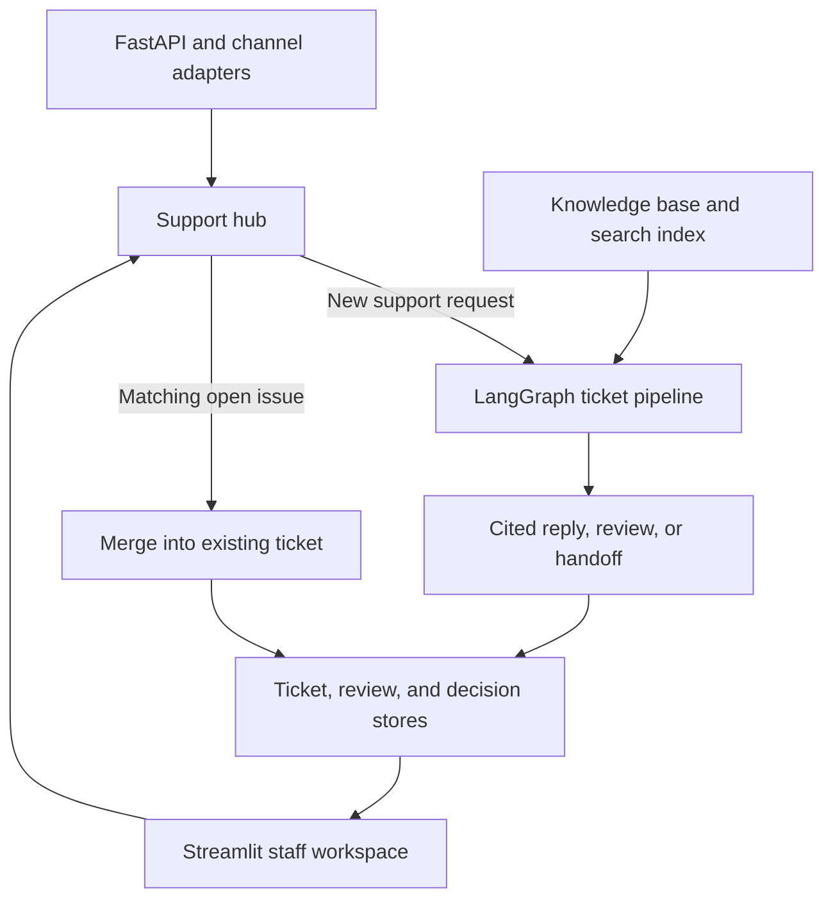

# Cirrus AI

Cirrus AI is an **omnichannel support hub** for the fictional CloudServe Solutions case study. It brings email, live chat, documentation comments, and community forum tickets into one queue. For each support request, Cirrus looks up relevant help articles and prepares a cited reply or a handoff with context for an agent.

I initially proposed a customer chatbot. Discovery showed that agents struggled to find approved answers and that escalations often arrived without enough context. I built a staff workspace where supervisors can assign tickets and agents can inspect the evidence, edit a draft, and record their decision.

Forward Deployed AI Engineering capstone by **Incia Anand**.

## Contents

- [Setup](#setup)
- [Run the staff UI](#run-the-staff-ui)
- [Clear the queue and load tickets](#clear-the-queue-and-load-tickets)
- [Manage staff accounts](#manage-staff-accounts)
- [Run the API](#run-the-api)
- [Architecture and code flow](#architecture-and-code-flow)
- [Run tests](#run-tests)
- [Run an evaluation](#run-an-evaluation)
- [Navigate the repository](#navigate-the-repository)
- [Troubleshooting](#troubleshooting)

## Setup

Run these commands from a terminal with Git and Python 3.11 available. The examples use Bash or Zsh.

```bash
git clone https://github.com/Incia94/InciaAnand_Capstone_Submission.git
cd InciaAnand_Capstone_Submission
python3.11 -m venv .venv
source .venv/bin/activate
python -m pip install --upgrade pip
python -m pip install -r requirements.txt
cp -n .env.example .env
python -m src.staff demo
```

The last command creates the demo staff accounts (**marcus**, the supervisor, and **asha**, **sofia** and **ravi**, the agents). It asks you to type one shared password twice; nothing appears on screen while you type. Passwords are never read from code or settings, and only a salted hash is stored, in `storage/staff.json`. To create other accounts, see [Manage staff accounts](#manage-staff-accounts).

Edit [the settings template](.env.example)'s local copy, `.env`, before starting the demo.

| Setting | Local setup |
| --- | --- |
| `GENERATOR` | Set `extractive` for a demo without an API key. Replies use the help articles directly. Set `llm` for optional model-written drafts. |
| `OPENROUTER_API_KEY` | Remove the placeholder for an extractive run. For an LLM run, provide a real key and set `MODEL_NAME` to a model available to your account. |
| `REPLY_MODE` | Keep `review` for the staff walkthrough. Cirrus holds support drafts for approval. Fixed conversational replies use approved text. |
| `CHANNEL_POLICY` | Keep `channel` for the default rules. Use `uniform` for a labelled offline comparison. |
| `RETRIEVAL_BACKEND` | The template uses `hybrid`. Set `lexical` for local keyword search without a dense index or embedding model download. |

Keep `.env` out of version control. With hybrid retrieval, the evaluation runner attempts to build the missing Chroma index and calibrate thresholds on the development set. For dense retrieval in the UI on a fresh checkout, run the [validation command](#run-an-evaluation) first, or build the index explicitly:

```bash
python -m src.ingest docs
```

## Run the staff UI

From the repository root with the virtual environment active:

```bash
python -m streamlit run streamlit_app.py
```

Open [the staff dashboard](http://localhost:8501). Streamlit calls the Python support hub directly, so it can run on its own. If you also start FastAPI from the same checkout with the same database settings, both interfaces see the same tickets and decisions.

1. Sign in as **marcus**, the supervisor, with the demo password. In **Ticket queue**, click **Add sample tickets** to load simulated traffic.
2. Assign an unassigned ticket with a draft or handoff to **Asha**. Open **Reports** to see ticket volume, channel breakdown, and the decision log.
3. Sign out and sign in as **asha** with the same demo password. Under **My tickets**, open the assigned ticket and inspect the customer report, help articles, and decision trail.
4. Review or edit the suggested reply. Use **Send reply** when available to record the approved reply and resolve the ticket, or **Mark resolved** to close it without a reply. Live delivery to external channels requires a connector.

## Clear the queue and load tickets

Stop Streamlit (and the API) first, because they hold the queue open.

| To | Run |
| --- | --- |
| Empty the queue: tickets, waiting replies and the live decision log (type `reset` to confirm) | `python -m src.hub reset` |
| Load real tickets from a file, each through its own channel | `python -m src.hub load data/validation_tickets.json --count 10` |
| Load the next ten from the same file | `python -m src.hub load data/validation_tickets.json --skip 10 --count 10` |

Then start Streamlit again. Loading the same tickets twice adds nothing. While Streamlit is running, **Refresh** shows tickets that arrived since the page loaded, and each click of **Add sample tickets** brings in a new random set. Evaluation runs keep their own files and are never touched.

## Manage staff accounts

Accounts are created at the terminal; every password is typed at a hidden prompt, twice.

| To | Run |
| --- | --- |
| Create an account (asks for username, full name, team, role, then the password) | `python -m src.staff add` |
| Create one with the details given up front (asks only for the password) | `python -m src.staff add priya --name "Priya Shah" --team Billing --role agent` |
| List accounts (never passwords) | `python -m src.staff list` |
| Set a new password | `python -m src.staff reset-password priya` |
| Delete an account (type the username to confirm) | `python -m src.staff remove priya` |
| Create or reset the four demo accounts | `python -m src.staff demo` |

## Run the API

In a terminal at the repository root:

```bash
source .venv/bin/activate
python -m src.api
```

Open [interactive API docs](http://127.0.0.1:8000/docs). If `API_PORT` differs, use the address printed at startup. Try the example body for `POST /tickets` in Swagger. Use the returned ticket ID to fetch its decision trail.

| Endpoint | Use it to |
| --- | --- |
| `GET /health` | Inspect classifier, retrieval, generator, and decision-store readiness. |
| `POST /tickets` | Process a ticket using the unified schema. |
| `POST /channels/{channel}` | Accept a native payload for `email`, `chat`, `forum`, or `docs_comment`. |
| `POST /hub/simulate?count=8` | Seed sample tickets through the hub. |
| `GET /hub/tickets/{ticket_id}` | Inspect the stored ticket, conversation, sources, and review state. |
| `GET /tickets/{ticket_id}/decisions` | Read the stage-by-stage decision trail. |
| `GET /search?q=rate%20limit` | Search the knowledge base and inspect cited passages. |

## Architecture and code flow



The hub loads thread history and checks for duplicates before invoking the graph. The graph normalizes and screens the request, classifies its intent and urgency, retrieves passages, and routes the ticket. Eligible replies are drafted from the retrieved evidence and checked by guardrails. Review settings and channel rules determine whether to hold a reply or hand the ticket to an agent. The decision log records the path taken.

See [architecture.md](docs/architecture.md) for the processing branches, resolution tiers, data stores, and how batch evaluation uses the same graph.

## Run tests

```bash
python -m pytest -q
python -m pytest -q tests/test_streamlit_app.py tests/test_api.py
python -m pytest -q tests/test_harness.py tests/test_check_run.py
```

The first command runs the full suite. The next two target the UI and API, then the evaluation runner and integrity checker. [GitHub Actions](.github/workflows/ci.yml) runs syntax and lint checks, runs pytest with coverage, and uploads the test reports.

## Run an evaluation

Run the complete labelled validation set from the repository root. The batch runner reads the ticket file directly and can run without either server.

```bash
./run.sh data/validation_tickets.json evaluation/results/validation
python -m evaluation.check_run evaluation/results/validation
```

The wrapper prepares the environment and invokes [the evaluation harness](evaluation/harness.py). It accepts a JSON list, a JSON object with a `tickets` list, or JSON Lines. The first run can take longer while it prepares the local index, classifier, and thresholds. Each run gets a dated subdirectory. The checker accepts that exact directory or finds the newest report inside a parent directory.

For a quick smoke run, or for an assessor-supplied hidden set, use separate output paths:

```bash
./run.sh data/validation_tickets.json evaluation/results/smoke --limit 5
python -m evaluation.check_run evaluation/results/smoke

./run.sh /path/to/hidden_tickets.json evaluation/results/hidden
python -m evaluation.check_run evaluation/results/hidden
```

Keep hidden tickets out of development and version control. To add the optional model judge, pass `--judge` after the output path and configure a provider key. Use `--truth PATH` when you have reference answers that match the evaluated set.

| Run file | What to inspect |
| --- | --- |
| `metrics.md` | Readable metrics, target thresholds, and generator breakdown. |
| `metrics.json` | Run metadata, decision-log reconciliation, and metrics for further analysis. |
| `outcomes.jsonl` | Per-ticket reply or handoff, tier, sources, and reason. |
| `decisions.jsonl` | Export of stage-by-stage governance records. |
| `decisions.db` | SQLite decision log created by default for that run. |

**Run integrity and metric targets are reported separately.** In the [saved validation run](evaluation/results/validation/eval-20261127T185905Z-c3a210/metrics.md), all 80 tickets were processed, the decision log reconciled, and 7 of 11 targets were met. The harness can count drafts held for review in its first-contact-resolution figure. Treat that figure as offline answerability in review mode. Production first-contact resolution requires closure without human involvement. For policy comparisons, keep the input, generator, and other settings fixed, use a separate output directory, and check the **Generators** line in each report.

## Navigate the repository

Start with [`streamlit_app.py`](streamlit_app.py) for the staff experience, [`src/hub.py`](src/hub.py) for ticket handling, or [`src/api.py`](src/api.py) for the API and pipeline graph.

| Source file | Responsibility |
| --- | --- |
| [`src/__init__.py`](src/__init__.py) | Marks `src` as a Python package. |
| [`src/api.py`](src/api.py) | Exposes FastAPI endpoints and defines the LangGraph pipeline and its outcomes. |
| [`src/channels.py`](src/channels.py) | Adapts native payloads from all four channels and generates simulated traffic. |
| [`src/classify.py`](src/classify.py) | Trains, loads, and runs the intent and urgency classifier. |
| [`src/contextual.py`](src/contextual.py) | Suggests help articles using page context, error codes, or a search query. |
| [`src/conversation.py`](src/conversation.py) | Detects conversational or unclear messages and supplies fixed, localised replies. |
| [`src/formatting.py`](src/formatting.py) | Formats reply text and citations for each channel. |
| [`src/gaps.py`](src/gaps.py) | Records unanswered searches and groups knowledge gaps from the decision log. |
| [`src/generate.py`](src/generate.py) | Builds cited replies from retrieved passages using a model or extractive fallback. |
| [`src/guardrail.py`](src/guardrail.py) | Checks draft replies for issues such as private data and unsupported claims before release. |
| [`src/hub.py`](src/hub.py) | Coordinates intake, deduplication, thread history, storage, assignment, and agent actions. |
| [`src/ingest.py`](src/ingest.py) | Normalizes tickets and loads, chunks, embeds, and indexes knowledge-base articles. |
| [`src/logging_store.py`](src/logging_store.py) | Persists, exports, and reconciles the SQLite decision log. |
| [`src/policy.py`](src/policy.py) | Defines resolution tiers, rollout phases, and channel-specific automation rules. |
| [`src/retrieve.py`](src/retrieve.py) | Ranks knowledge-base passages with lexical, dense, or hybrid search. |
| [`src/review.py`](src/review.py) | Stores held replies and handles approval, edit checks, rejection, and closure. |
| [`src/route.py`](src/route.py) | Decides whether to answer or escalate and builds a handoff with reasons and sources. |
| [`src/scope.py`](src/scope.py) | Screens incoming messages before retrieval and generation. |
| [`src/staff.py`](src/staff.py) | Creates and authenticates staff accounts and supplies role information. |
| [`src/workspace.py`](src/workspace.py) | Builds ticket cards, agent views, and supervisor reports for Streamlit. |

| Other paths | What to look for |
| --- | --- |
| [`streamlit_app.py`](streamlit_app.py) | Staff sign-in, supervisor queue and reports, and the agent ticket view. |
| [`run.sh`](run.sh) and [`evaluation/harness.py`](evaluation/harness.py) | Unattended batch entry point, artifact preparation, processing, and scoring. |
| [`evaluation/check_run.py`](evaluation/check_run.py) and [`evaluation/judge.py`](evaluation/judge.py) | Run integrity checks and optional model-based answer review. |
| [`tests/`](tests/) and [`prompts/`](prompts/) | Automated checks and versioned prompts for generation, translation, and evaluation. |
| [`data/documentation.json`](data/documentation.json) | The approved knowledge-base corpus. |
| [`data/development_tickets.json`](data/development_tickets.json) | Labelled tickets used for training and calibration. |
| [`data/validation_tickets.json`](data/validation_tickets.json) | Labelled validation tickets used to measure behavior. |
| [`data/ground_truth_responses.json`](data/ground_truth_responses.json) | Reference answers for development tickets. |

## Troubleshooting

| Symptom | Check |
| --- | --- |
| Staff sign-in fails, or Streamlit says there are no staff accounts | Run `python -m src.staff demo` and type a password, or `python -m src.staff reset-password <username>` to set a new one. `python -m src.staff list` shows which usernames exist. |
| The supervisor queue is empty | Click **Add sample tickets**. In the agent view, a supervisor assignment is required before the ticket appears. |
| The API reports degraded retrieval or generation | Inspect `GET /health`. An extractive setup reports degraded generation by design. Build the index for dense retrieval, or use `RETRIEVAL_BACKEND=lexical` intentionally. |
| An evaluation processed fewer tickets than expected | Check the input path and whether `--limit` was used. Use a fresh output directory for the full run. |
