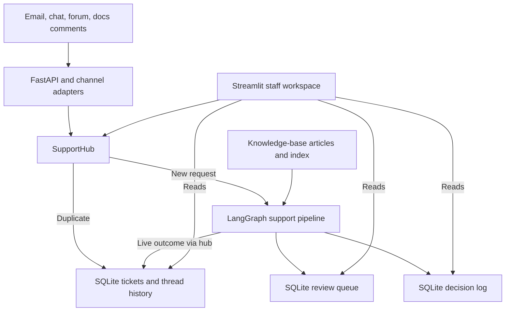
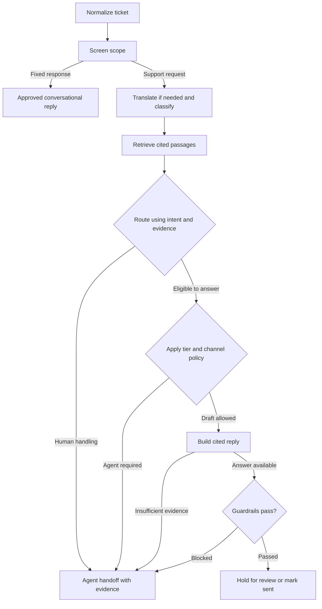

# Cirrus AI architecture

[Back to the README](../README.md)

Cirrus AI has two interactive entry points and one batch entry point. The Streamlit dashboard and FastAPI call the same support hub and use the same configured stores. The evaluation harness calls the underlying LangGraph pipeline directly and scores each input ticket independently.

## System overview

The API accepts unified tickets and native channel payloads. Streamlit calls Python services in its own process, so it can run independently of FastAPI. In the demo, the hub records approved replies and returns the content for delivery. Email, chat, forum, and docs-comment connectors would perform the external delivery.

## Live ticket flow

1. **Intake.** [`api.py`](../src/api.py) accepts `POST /tickets` or `POST /channels/{channel}`. The latter uses [`channels.py`](../src/channels.py) to adapt a native payload. Streamlit's **Add sample tickets** action uses the same hub with simulated channel payloads.
2. **History and deduplication.** [`hub.py`](../src/hub.py) normalizes the ticket, attaches messages from the same thread, and checks for a matching open issue from the same customer. A matching issue is merged and logged. For a new issue, `SupportHub.handle()` calls `SupportPipeline.run()`.
3. **Processing.** The graph normalizes and screens the request. For an in-scope support ticket, it can translate the ticket, classify intent and urgency, retrieve relevant evidence, and choose between a reply and a human handoff.
4. **Outcome and persistence.** Drafted replies go through guardrails. The hub formats replies for the channel, stores the ticket and conversation, and exposes its evidence and decision trail to the workspace. Reviewable replies and escalations can appear in the review queue.
5. **Staff action.** A supervisor assigns the ticket. The assigned agent reviews the sources and can save, approve, edit, or close the ticket from the dashboard. [`review.py`](../src/review.py) checks edited replies before approval and logs the action. [`workspace.py`](../src/workspace.py) prepares the dashboard views and reports.

## Pipeline branches

Start in `SupportPipeline._build_graph()` in [`src/api.py`](../src/api.py) to trace the transitions. [`route.py`](../src/route.py) makes the answer-or-escalate decision. [`policy.py`](../src/policy.py) applies rollout and channel limits. [`generate.py`](../src/generate.py) builds replies from evidence, and [`guardrail.py`](../src/guardrail.py) checks them before release. The graph also logs errors and can escalate when the kill switch is active. Every graph path reaches outcome logging.

| Resolution tier | What happens |
| --- | --- |
| **0 · Fixed reply** | Rules handle greetings, out-of-scope messages, and other supported conversational cases with approved text. |
| **1 · Approved content** | A strong article match supplies cited resolution steps. |
| **2 · Retrieval-augmented reply** | Cirrus drafts a cited answer from relevant passages. The extractive generator provides a key-free fallback. |
| **3 · Human handling** | An agent gets a handoff and, when evidence permits, a cited draft. |

With `REPLY_MODE=review`, eligible support replies are held for approval. Channel policy operates earlier in the graph. Tier 2 email cases go to an agent, while forum automation is limited to documentation and related thread pointers. `CHANNEL_POLICY=uniform` applies live-chat-style routing limits across channels for comparison.

## Data and storage

| Store | Default location | Contents |
| --- | --- | --- |
| Knowledge base | [`data/documentation.json`](../data/documentation.json) | Approved source articles used for retrieval and citations. |
| Dense index | `storage/chroma/` | Article embeddings used by dense or hybrid search. Lexical retrieval can use the corpus directly. |
| Classifier and thresholds | `storage/models/classifier.joblib`, `storage/retrieval.json`, `storage/routing.json` | Trained intent and urgency models and calibrated retrieval and routing settings. |
| Ticket store | `storage/tickets.db` | Tickets, messages, duplicate links, assignments, and status. |
| Review queue | `storage/reviews.db` | Held replies, escalations, and review state. |
| Decision log | `storage/decisions.db` | Stage decisions, reasons, evidence, and outcomes. |
| Staff directory | `storage/staff.json` | Staff identities, roles, and salted password hashes. |

See [`.env.example`](../.env.example) for path overrides. The default ticket and review databases are located beside the decision log. Staff sign-in applies to the Streamlit workspace. The machine API is intended for local use or trusted integrations and requires authentication before public deployment.

## Batch evaluation flow

[`run.sh`](../run.sh) invokes [`evaluation/harness.py`](../evaluation/harness.py). The harness prepares missing artifacts with development data, reads the evaluation file, and calls `SupportPipeline.run()` for each record. Calling the graph directly gives each input ticket its own evaluation outcome before any live-hub deduplication or staff assignment. The harness writes per-ticket outcomes and a run-specific decision log, computes metrics, and optionally invokes [`evaluation/judge.py`](../evaluation/judge.py) to assess replies.

[`evaluation/check_run.py`](../evaluation/check_run.py) checks completion, outcome accounting, and decision-log reconciliation. The metric report evaluates quality targets separately. See [the evaluation commands](../README.md#run-an-evaluation) for validation, smoke, and hidden-set runs.
