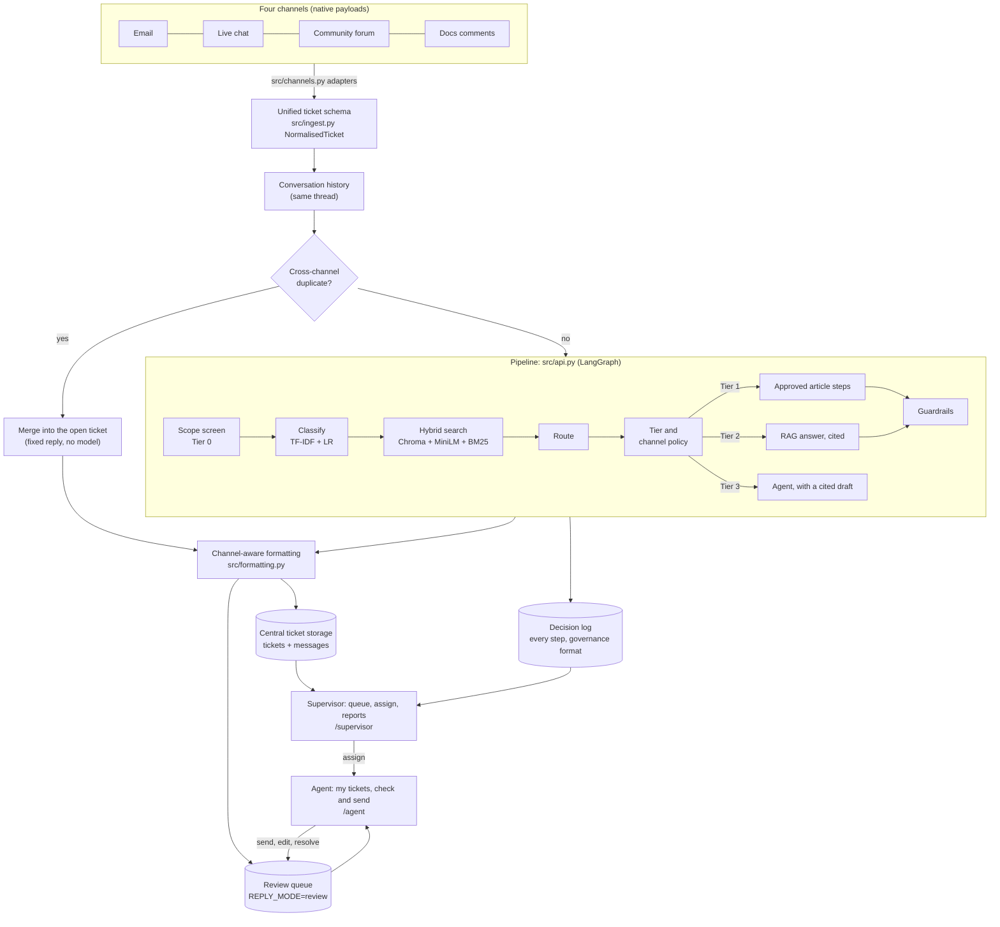

# Cirrus AI: the support resolution hub

One support intelligence engine for CloudServe. It serves two audiences from the same core:

- **customers**, on four channels: email, live chat, the community forum and documentation comments;
- **CloudServe employees**, through one dashboard and API for every channel.



## Features and where they live

| Feature | Priority | Where | How it works |
|---|---|---|---|
| Unified ticket schema | P0 | `src/ingest.py` (`NormalisedTicket`) | Every channel becomes the same ticket: text, channel, customer (id, name, contact address and a hashed `customer_key`), thread, language and flags. The name and address are kept for the record and never put in the text the models read. |
| Common ticket processing API | P0 | `src/api.py` | `POST /tickets` takes a unified ticket. `POST /channels/{email,chat,forum,docs_comment}` takes a channel's own payload. Both go through the same hub and pipeline. |
| Channel-aware response formatting | P0 | `src/formatting.py` | One checked reply, laid out per channel. **Email:** subject, greeting, full article links, ticket reference, signature. **Chat:** first three steps plus compact links. **Forum:** public Markdown, no ticket reference, moderator note. **Docs comment:** first two steps plus the article link. Only fixed text is added, so the guardrails' verdict still holds. |
| Centralised ticket storage | P0 | `src/hub.py` (`TicketStore`) | `tickets.db`, beside the decision log, holds every ticket's status, handling, reply and duplicate link. Every message is kept per ticket and per customer. Personal data in the text is masked. |
| Decision logging | P0 | `src/logging_store.py` | Every step of every ticket is logged: deduplication, ingest, screen, classification, retrieval, routing, tier, generation, validation, outcome and human review. Records follow the Governance Framework format (`export`), and the coverage check reconciles both counts and paths. |
| Simulated four-channel ingestion | P0 | `src/channels.py` | `simulate()` renders dataset tickets as native email, chat, forum and docs-comment payloads. It adds a cross-channel duplicate and a same-session follow-up. Run it with `python -m src.channels simulate --post URL` or `POST /hub/simulate`. |
| Unified employee dashboard | P1 | `streamlit_app.py` (Streamlit) and `src/web/` (HTML), both over `src/workspace.py` and `src/staff.py` | Staff sign in at `/`. **Supervisors** (`/supervisor`) see every ticket from every channel, unassigned and assigned. They assign tickets to agents and see Reports: ticket volume, tickets by channel, how tickets were handled, and the decision log (one line per ticket, every step on click). **Agents** (`/agent`) see only their own tickets. Each one shows the customer report, Cirrus's findings with the help articles, and the suggested reply with its citations. The agent checks or edits it, then sends it or marks the ticket resolved. Everything on screen is in plain words. |
| Cross-channel deduplication | P1 | `src/hub.py` (`_duplicate_of`) | A ticket is merged into an earlier one when: same `customer_key`; the earlier ticket is still open; it arrived within `DEDUP_WINDOW_HOURS`; it's in a different thread; and the texts are at least `DEDUP_SIMILARITY` alike (character n-gram TF-IDF cosine). The duplicate is logged as its own ticket, with ingest, dedup and outcome `merged`. |
| Conversation history | P1 | `src/hub.py`, `src/scope.py` | Earlier messages in the same thread are attached to each new message. If the customer says the earlier answer didn't work, the ticket goes to an agent, with the earlier question used to find the right articles. `GET /customers/{key}/history` returns a customer's history across channels. |

## Running it

```bash
streamlit run streamlit_app.py         # the support workspace in Streamlit: http://localhost:8501
python -m src.api                      # the API, plus the same screens in plain HTML: http://127.0.0.1:8000
python -m src.channels simulate --count 12 --post http://127.0.0.1:8000
./run.sh data/validation_tickets.json  # unattended evaluation of any ticket file
```

The evaluation harness runs the pipeline on its own. Deduplication and storage belong to the live hub, so every evaluated ticket is scored on its own merits.

Staff sign in with a username: `marcus` (supervisor; `admin` also works) or `asha`, `sofia`, `ravi` (agents). For demos, these four accounts are created on first use with the password you set as `DEMO_PASSWORD` in `.env`; no password is written in the code, and without `DEMO_PASSWORD` no demo accounts are made (`DEMO_ACCOUNTS=off` turns them off). Only a salted hash of each password is stored, in `storage/staff.json`, which git ignores. Real accounts are added with `python -m src.staff add`, which asks for the password. Sign-in uses a random session cookie (HttpOnly, SameSite=Lax) that lasts 12 hours. Agents can open and act on only their own tickets; supervisors can open any ticket but not send replies.

The machine API (`/tickets`, `/channels/*`, `/hub/*`, `/reviews/*`, `/search`) is not behind staff sign-in. It's meant for channel connectors on a trusted network; on a public network it would need its own authentication.
